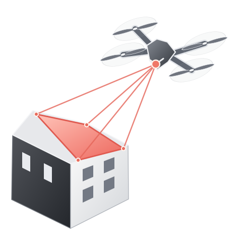
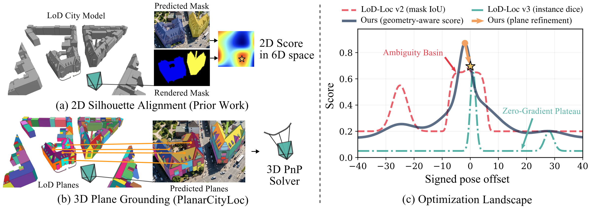

<div align="center">



<h3>PlanarCityLoc: Breaking Silhouette Ambiguity in LoD Aerial Localization via 3D Planes</h3>
<p><strong>WACV 2027</strong></p>

<p>
  <a href="https://tum-vision.github.io/PlanarCityLoc/"></a>
  <a href="https://youtu.be/oDJtUY4ZRsE"></a>
  
  <a href="https://tum-vision.github.io/PlanarCityLoc/assets/PlanarCityLoc-WACV2027-poster.pdf"></a>
  <a href="data/README.md"></a>
  <a href="LICENSE"></a>
</p>

<p align="center">
  <a href="https://ussaema.github.io">Oussema Dhaouadi</a><sup>1,2,4,5,6</sup>,
  <a href="https://www.linkedin.com/in/shaojiehuchen/">Shao Jie Hu Chen</a><sup>1,2</sup>,
  <a href="https://www.linkedin.com/in/jakob-gollreiter-939615194/">Jakob Gollreiter</a><sup>1,2</sup>,<br>
  <a href="https://www.linkedin.com/in/samir-jusufi/">Samir Jusufi</a><sup>1,3</sup>,
  <a href="https://www.linkedin.com/in/nikolas-rieger/">Nikolas Rieger</a><sup>1,2,7</sup>,
  <a href="https://www.linkedin.com/in/caroline-wendlandt/">Caroline Wendlandt</a><sup>1,2</sup>,<br>
  <a href="https://www.linkedin.com/in/christian-wender/">Christian Wender</a><sup>1,8</sup>,
  <a href="https://www.linkedin.com/in/jingfeng-mao-125928260/">Jingfeng Mao</a><sup>1,2,4</sup>,
  <a href="https://www.linkedin.com/in/guangming-wang/">Guangming Wang</a><sup>1,4</sup>,<br>
  <a href="https://zuriabauer.com/">Zuria Bauer</a><sup>5</sup>,
  <a href="https://cvg.ethz.ch/team/Prof-Dr-Marc-Pollefeys">Marc Pollefeys</a><sup>5,9</sup>,
  <a href="https://cvg.cit.tum.de/members/cremers">Daniel Cremers</a><sup>2,6</sup>,
  <a href="https://olafwysocki.github.io/">Olaf Wysocki</a><sup>1,4</sup>
</p>

<p>
  <sup>1</sup> TUM.ai &nbsp; <sup>2</sup> Technical University of Munich &nbsp; <sup>3</sup> LMU Munich<br>
  <sup>4</sup> University of Cambridge &nbsp; <sup>5</sup> ETH Zürich<br>
  <sup>6</sup> Munich Center for Machine Learning<br>
  <sup>7</sup> Konrad Zuse School of Excellence in Reliable AI (relAI)<br>
  <sup>8</sup> BMW Group &nbsp; <sup>9</sup> Microsoft
</p>

</div>

<p align="center">
  <picture>
    <source media="(prefers-color-scheme: dark)" srcset="assets/teaser-dark.png" />
    <source media="(prefers-color-scheme: light)" srcset="assets/teaser-light.png" />
    
  </picture>
</p>

PlanarCityLoc estimates the 6-DoF pose of an aerial image in a textureless
level-of-detail (LoD) city model. Silhouette alignment provides a coarse pose
estimate. Explicit correspondences between image regions and 3D building
planes then refine the camera pose.

## 🛰️ Method

- **Planar grounding:** associate visible image regions with 3D building planes.
- **Geometry-aware search:** use image masks, edges, and depth to initialize pose.
- **Training-free refinement:** match facade and roof regions, then refine the
  pose with geometric constraints.

## 📊 Results

Joint recall requires both translation and rotation errors to be below the
listed threshold.

| Evaluation split | Queries | Recall @ 2 m / 2° | Median translation | Median rotation |
|---|---:|---:|---:|---:|
| UAVD4L-LoDv2 in-Traj | 1,604 | 75.4% | 1.28 m | 0.68° |
| UAVD4L-LoDv2 out-of-Traj | 2,192 | 80.6% | 1.26 m | 0.69° |
| Swiss-EPFLv2 in-Place | 712 | 20.6% | 3.70 m | 1.90° |
| Swiss-EPFLv2 out-of-Place | 379 | 48.5% | 1.98 m | 1.21° |

## 🛠️ Setup

The reference environment uses Linux, Python 3.10, PyTorch 2.6, CUDA 12.4,
and an NVIDIA GPU.

```bash
git clone https://github.com/tum-vision/PlanarCityLoc.git
cd PlanarCityLoc

conda create -n planarcityloc python=3.10 -y
conda activate planarcityloc
conda install -y -c nvidia cuda-nvcc=12.4.131 cuda-cudart-dev=12.4.127
conda install -y -c conda-forge cxx-compiler

pip install torch==2.6.0 torchvision==0.21.0 \
  --index-url https://download.pytorch.org/whl/cu124
pip install -r requirements.txt
pip install "setuptools<81" wheel ninja
pip install git+https://github.com/NVlabs/nvdiffrast.git@abb07ca0358f3a21c3942b50c54aa1eacd329af9 \
  --no-build-isolation
GIT_LFS_SKIP_SMUDGE=1 pip install --no-deps \
  git+https://github.com/microsoft/MoGe.git@07444410f1e33f402353b99d6ccd26bd31e469e8
```

Run commands from the repository root with `PYTHONPATH=.`.

## 🗺️ Data and models

Benchmark assets and model weights are not hosted in this repository. Obtain
them from their original providers, follow the providers' terms, and arrange
the files as described in [`data/README.md`](data/README.md) and
[`DATA_PROVENANCE.md`](DATA_PROVENANCE.md). The setup helper links locally
available benchmark files, query images, and checkpoints:

```bash
bash scripts/setup_data_links.sh /path/to/extracted/data /path/to/checkpoints
```

After accepting the upstream SAM 3 model terms, prepare the compact
building-prompt checkpoint with:

```bash
PYTHONPATH=. python scripts/prepare_sam3_fast.py
```

The script downloads the full checkpoint through your authorized Hugging Face
account, or accepts a local checkpoint with `--full-checkpoint /path/to/sam3.pt`.
MoGe-2 downloads automatically at the revision pinned in the configuration.
See [`THIRD_PARTY_NOTICES.md`](THIRD_PARTY_NOTICES.md) for component licenses.

## 🚀 Run

A small smoke run on UAVD4L-LoDv2 in-Traj:

```bash
PYTHONPATH=. python pipeline.py \
  --dataset uavd4l \
  --data_root data/UAVD4L-LoD/inTraj \
  --batchsize 8 --no-crop --n 3 \
  --out outputs/demo_intraj
```

For the reported full-split evaluation, use batch size 512 and a new output
directory:

```bash
PYTHONPATH=. python pipeline.py \
  --dataset uavd4l \
  --data_root data/UAVD4L-LoD/inTraj \
  --batchsize 512 --no-crop \
  --out outputs/eval_uavd4l_intraj
```

Each run records its configuration, source hashes, inputs, and environment.
To verify a run and recompute metrics from its saved poses:

```bash
PYTHONPATH=. python scripts/summarize_results.py outputs/eval_uavd4l_intraj
```

Full-split commands, dataset layout, and evaluation details are in
[`docs/REPRODUCIBILITY.md`](docs/REPRODUCIBILITY.md). Component studies are
described in [`docs/ABLATIONS.md`](docs/ABLATIONS.md).

The evaluation protocol is in [`configs/evaluation.json`](configs/evaluation.json),
with expected full-split results in [`docs/benchmark_results.json`](docs/benchmark_results.json).

## 📝 Citation

```bibtex
@inproceedings{dhaouadi2027planarcityloc,
  title     = {{PlanarCityLoc}: Breaking Silhouette Ambiguity in {LoD} Aerial Localization via 3{D} Planes},
  author    = {Dhaouadi, Oussema and Hu Chen, Shao Jie and Gollreiter, Jakob and Jusufi, Samir and Rieger, Nikolas and Wendlandt, Caroline and Wender, Christian and Mao, Jingfeng and Wang, Guangming and Bauer, Zuria and Pollefeys, Marc and Cremers, Daniel and Wysocki, Olaf},
  booktitle = {IEEE/CVF Winter Conference on Applications of Computer Vision (WACV)},
  year      = {2027}
}
```

## ⚖️ License

PlanarCityLoc code is released under [CC BY-NC 4.0](LICENSE). Third-party
software, models, and benchmark data retain their respective terms.
